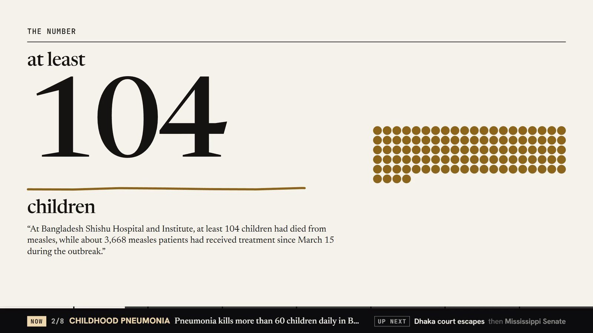
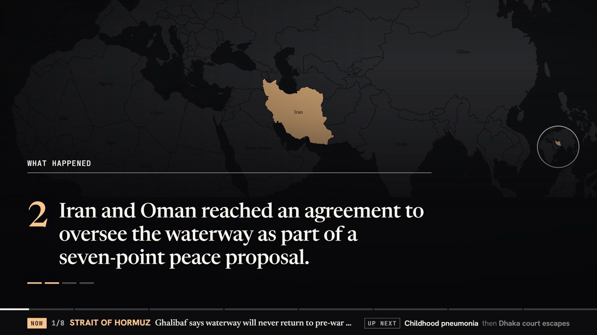
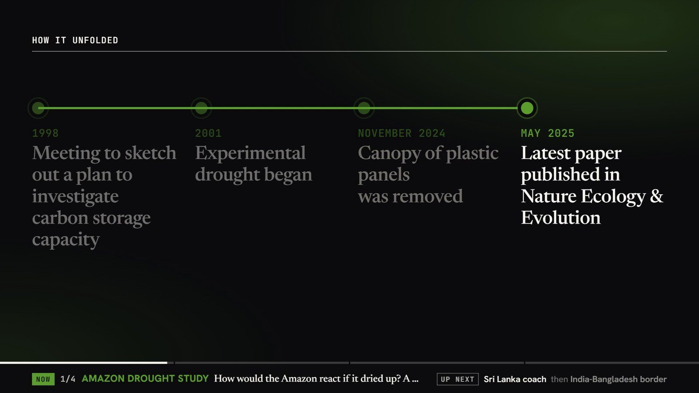
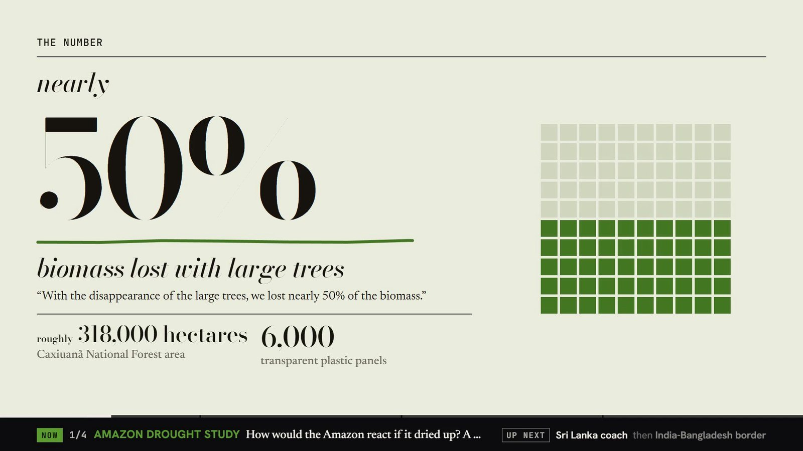
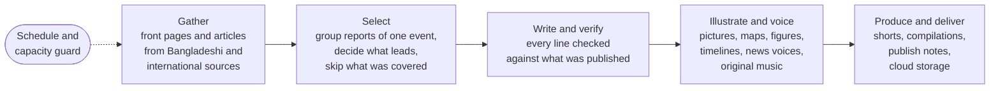

<p align="center"></p>

<p align="center"><b>An unattended local newsroom that gathers, checks, voices and produces the news on one consumer PC.</b></p>

<p align="center">
  
  
  
</p>

Daily News Kernel is a newsroom that runs by itself on a single desktop computer. Every few hours it reads Bangladeshi and international news sources, decides what leads, writes each story and checks every line against what the sources actually published, then turns the result into narrated news shorts and longer compilations with pictures, maps, figures and original music. All of the reading, writing, voicing and rendering happens on that one machine; only the finished videos and their notes are uploaded.

> **Status:** research preview · closed source · commercial release planned

## Contents

- [Highlights](#highlights)
- [Showcase](#showcase)
- [How it works, at a glance](#how-it-works-at-a-glance)
- [Research discussion](#research-discussion)
- [Roadmap](#roadmap)
- [The family](#the-family)
- [Availability](#availability)
- [Citation](#citation)
- [License](#license)

## Highlights

- **Unattended.** In its first 35 hours on a schedule (11 to 12 November 2026) it ran 16 news checks, produced 84 stories as 84 shorts, made 9 compilations and delivered all 25 output folders to cloud storage. All but two runs were started by the clock.
- **Checked line by line.** Every fact, figure, quote and date must be found in what an outlet published. In those 35 hours the checks removed 181 of 1,697 extracted items and caught 85 written lines that went further than the sources.
- **Qualifiers survive.** "At least 28" stays "at least 28". A figure that loses the "about" or "more than" its sources give it is caught before it reaches the screen.
- **No editorialising.** A "why it matters" line appears only when a source said it. In 69 of the 84 autopilot stories no source did, so none was written.
- **Bangladesh first, the world in view.** 64 sources across nine desks, including a dedicated Bangladesh desk that supplied 32 of the 84 autopilot stories.
- **A news team, not a single voice.** Original synthetic presenters, all speaking Bangladeshi English, share the reading according to the kind of story. One compilation on 12 November was read by six voices.
- **A picture for every point.** Key points play over their own pictures, maps or source footage, changing as the presenter reaches each one. Figures, timelines and quotes move as they are read.
- **Short and long form from one edition.** A vertical short for each new story and a chaptered compilation every few hours, each delivered with publish notes: title, description, chapters, summary, keywords and credits.
- **Built for a shared, unreliable PC.** It waits when the computer is busy and resumes after a crash or power cut. One run cut short by a power loss finished by itself after the restart.

## Showcase

These stills come from two compilations the autopilot made on its own on 12 November 2026. Frames showing news photographs are left out on purpose, because those pictures belong to their outlets and agencies. In the videos themselves, most cards sit over a photograph, a map or a clip from the story.

<p align="center"></p>

**The number, as the sources gave it.** A figure is shown only in the form its sources used, so "at least 104" never becomes "104". The sentence it rests on sits underneath, and the chart counts up to the published value. The strip along the bottom is the compilation's chapter bar: the story playing now and the two that follow.

<p align="center"></p>

**A point over its own picture.** Each key point gets its own backdrop, which changes as the presenter reaches the next point. When the place matters and the viewer may not know it, the backdrop is a map with a locator. Words sit on a dark wash so they stay readable on any image.

<p align="center"></p>

**How it unfolded.** When a story has real dates, the system builds a timeline in calendar order. The rail draws from one event to the next as each is read out, and events still to come are marked as such. This frame uses the magazine look, one of three.

<p align="center"></p>

**The same rules in another look.** "Nearly 50%" and "roughly 318,000 hectares" keep their qualifiers here too. A look changes type, colour and chart style; it never changes what is claimed.

<p align="center"></p>

**That was the news.** A compilation closes by naming the stories it covered, each word lighting up as the anchor reaches it, before the sign-off. The sources appear on the final card and the picture credits in the publish notes; neither is mixed into the story cards.

## How it works, at a glance



An edition starts on the clock. The newsroom reads its sources' front pages and articles the way an ordinary visitor would, groups reports of the same event across outlets, and decides which stories lead without letting the edition become all one subject. Stories told in recent days are skipped unless there is new reporting.

Each chosen story is read into evidence-backed material and written from what survives. A separate verification layer, which does not depend on the writer's own judgement, removes anything the sources do not support and lists it for a person to inspect. Only then does the story get its pictures, cards, voices and music, so nothing on screen or in the narration comes from outside the checked material. A scheduler above it all starts work only when the PC has room and resumes any unfinished job after a restart.

## Research discussion

### Abstract

We describe Daily News Kernel, a fully local, unattended newsroom that turns live reporting from 64 news sources into narrated, illustrated news videos on one consumer PC with an 8 GB graphics card. The system treats accuracy as a property of the whole pipeline rather than of the writer: every extracted fact, figure, quote and date must be traceable to published text, a verification layer independent of the writer removes what is not, and the narration and graphics may draw only on what survives. In its first 35 hours of scheduled operation it ran 16 news checks and produced 84 stories, 84 shorts and 9 compilations (about two hours of finished video) with only two manual starts, while its checks removed 10.7% of extracted items and caught 85 written lines that overreached their sources. We report what those checks catch, what they miss, which failures got through anyway, and what it takes to run a production pipeline on a desktop that is shared with other work and occasionally loses power.

### 1. Motivation

Automated news production is usually discussed in terms of speed. For a small newsroom, or a single person, the harder problem is trust. A pipeline that writes and publishes while no one is watching will eventually publish a mistake, and a mistake in news has consequences that a typo in a recipe does not. Language models write fluent news copy, and they also tidy quotes, generalise headlines and add explanations no source gave.

Bangladeshi news adds two pressures. Domestic stories move quickly and are often reported by only one or two outlets, and international aggregators cover the country thinly. A system that reads Bangladeshi and international sources side by side, writes plainly and refuses to go beyond what was published could serve audiences that are not well served today, provided it can run cheaply. That is why the whole system had to fit on one ordinary desktop, with all of its models running locally.

### 2. Research questions

1. Can an unattended pipeline on one consumer PC produce news videos in which every factual line is traceable to what a source published?
2. Which kinds of error survive automated checks on text, and which checks catch them without throwing away good material?
3. How much of a broadcast's craft (a picture per point, motion graphics, several voices, music) can be generated without inventing content?
4. How should a single shared 8 GB graphics card be scheduled so that a newsroom can run around the clock beside other work, and survive power loss?
5. What does strict accuracy cost in speed, coverage and editorial depth?

### 3. Design principles

1. **Nothing is made up to fill space.** The material decides which cards exist: a figure worth showing gets a number card, real dates get a timeline, and a story with neither simply has fewer cards. *Why:* filler is where invention creeps in.
2. **The checker is not the writer.** Verification is separate from writing and does not ask the writer's opinion of its own work. *Why:* in testing, a model asked to fact-check a model flagged many correct lines, and a checker that cries wolf gets ignored.
3. **The voice says only what the screen says, and the screen only what sources said.** Narration is built from the checked story; a person's own words in the editor are marked as unchecked. *Why:* in video, the spoken line is the claim viewers remember.
4. **Sources travel with the story.** Every video ends on its sources, and every export carries publish notes with credits. *Why:* a viewer should always be able to find the original.
5. **Be a good guest, on the web and on the PC.** The newsroom honours sites' crawling rules, paces its visits and never tries to get past paywalls or bot checks; on the desktop it waits for room and steps aside for the user's own work. *Why:* a tool that is rude to publishers or to its owner does not stay switched on.
6. **Every long job can resume.** Work is saved as it goes, and an interrupted run is picked up where it stopped. *Why:* the development PC has lost power without warning many times, and an unattended system cannot count on someone restarting it.

### 4. Approach

This section stays at the level of capabilities.

**Gathering.** The newsroom reads each source's front page and leading articles, keeping text, photographs with captions, video, byline and date. A site that declines visitors is noted, and its public feed is used if it has one. The 64 sources cover nine desks: World, Bangladesh, Politics, Business, Technology, Environment, Science, Magazines and Sport.

**Selection.** Reports of one event from different outlets are grouped into one story. Stories are ranked for news value. Repeats from recent days are skipped unless there is new reporting.

**Writing and verification.** Each story is first reduced to evidence, every piece tied to the published text it comes from, and then written from what survived. The verification layer checks both stages: quotes must be word for word with the speaker named, numbers and names must exist in the outlets cited, figures keep their qualifiers, a headline may not say more than the sources, a claimed cause needs a source that states it, and "why it matters" must be something an outlet said. Whatever fails is removed and listed on the story's Checks tab.

**Pictures, footage and graphics.** The system picks a cover that belongs to the story, keeps each photograph's subject in frame, drops repeated photographs and outlet branding bars, and screens saved clips so that adverts and unrelated footage stay out. For people and places a story names, it can add photographs from openly licensed photo archives, credited with author and licence. Maps, number cards, timelines, quotes and "what happens next" appear only when the material supports them.

**Voices, music and sound.** A team of original synthetic voices reads the news. The anchor opens and closes; the kind of story (tragedy, breaking news, politics, business, technology, science, sport, features and others) decides which voice reads it, how it opens and how a short ends. Each video gets an original music bed in a mood suited to its stories, with light sound effects, and is mastered for online platforms and measured after encoding.

**Production and delivery.** Slides and videos are drawn from the same layouts, so they cannot disagree, and one design system feeds the app, the slides and the videos. Output comes in three looks (broadsheet, poster, magazine) and three shapes (4:5, 9:16, 16:9). The autopilot checks for news every two to three hours, makes a short for each new story and a chaptered compilation every four to five hours, files everything in cloud storage by date and time, and notifies the user when it is waiting for the PC.

**People in the loop.** The newsroom is also a desktop app. Each edition opens on a printed-style front page, every story's sources and checks are one click away, a timeline editor lets a person re-cut any video or rewrite a presenter line, and quick editions start from the system tray.

### 5. Evaluation

**Unattended operation.** The autopilot ran on its own schedule from 02:00 on 11 November to 13:05 on 12 November 2026, about 35 hours. The first run used a small test configuration and the first compilation was started by hand as a test; one later compilation was started by hand while waiting for the PC. Everything else was started by the clock.

| Measure | Result | Date |
|---|---|---|
| Scheduled news checks | 16; one cut short by a power loss and run again automatically | 2026-11-11/12 |
| Sources read per check | 61 to 63 of 64 | 2026-11-11/12 |
| Articles collected per check | 298 to 307 | 2026-11-11/12 |
| Distinct stories found per check | 155 to 186 | 2026-11-11/12 |
| Stories produced | 84, of which 32 from the Bangladesh desk | 2026-11-11/12 |
| Shorts | 84, from 29 to 54 s (median 36 s); 75 voiced by the news team, the first 9 made before the voices were installed | 2026-11-11/12 |
| Compilations | 9, from 2 min 9 s to 12 min 13 s, about 73 min in all | 2026-11-11/12 |
| Finished video | about 126 min | 2026-11-11/12 |
| First page opened to last short finished | 36 to 83 min per edition, median 47 min (test run excluded) | 2026-11-11/12 |
| Output folders delivered to cloud storage | 25 of 25; 3 transient upload failures retried automatically | 2026-11-11/12 |
| Waits for the PC | 3 compilations waited for memory or the graphics card; 2 started by themselves when it freed up | 2026-11-11/12 |

**Checks during unattended operation**, counted over the same 16 editions.

| Measure | Result | Date |
|---|---|---|
| Extracted facts, figures, quotes and events | 1,697 proposed, 181 removed (10.7%) | 2026-11-11/12 |
| Removed: claim not supported by the passage it cites | 78 | 2026-11-11/12 |
| Removed: quote not word for word, or speaker not named | 78 | 2026-11-11/12 |
| Removed: figure, name, date or passage not found in the source | 16 | 2026-11-11/12 |
| Removed: figure stripped of its qualifier | 9 | 2026-11-11/12 |
| Written lines caught after writing | 85: 34 "why it matters" lines no outlet said, 22 headlines beyond the sources, 29 others (including 2 unsupported claims of cause) | 2026-11-11/12 |
| Stories with no "why it matters", because no source gave one | 69 of 84 | 2026-11-11/12 |
| Stories reported by a single outlet | 42 of 84 | 2026-11-11/12 |
| Stories with a photograph / with a source clip | 83 of 84 / 19 of 84 | 2026-11-11/12 |

**Targeted studies**, each run on saved, real editions.

| Study | Result | Date |
|---|---|---|
| Blind line-by-line review of six stories against their sources | Careful writing: 95% of lines correct, none wrong, ranked first in 5 of 6. Fast reading with careful writing: 89%, 2 wrong. Fast: 85%, 1 wrong | 2026-11-07 |
| Screening of 14 local models on the same articles and checks | 7 gave no usable output, 4 kept fewer checked facts, 1 was accurate but too slow for the hardware, 2 became the Fast and Careful settings | 2026-11-07 |
| Dropped-qualifier check on the review set | Flagged 1 of 114 lines, the one real error, with no false alarms | 2026-11-07 |
| A model as fact-checker | Flagged many correct lines; not adopted | 2026-11-07 |
| Layout check of every slide in three shapes and three looks, plus every video shot (about 2,500 renders) | Shots breaking lines differently from their slide: 57 of 963 before, 0 after; a stress set of worst-case text came out clean | 2026-11-07 |
| Freshness of front pages | Only 25% to 37% of front-page articles were under six hours old | 2026-11-09 |
| Picture use across three editions | 39 of 197 slides had a picture; one edition used 14 of the 45 photographs it collected | 2026-11-09 |
| Cover pictures | 3 of 30 saved covers were wrong; after the fix, 9 of 9 were right in the next edition | 2026-11-10 |
| Asking a model whether a picture belongs to the headline | Caught 2 of 8 stray pictures and rejected 1 of 26 good covers; not adopted | 2026-11-10 |
| Outlet branding bars on saved pictures | Found on 5 of 151, with no false detections | 2026-11-11 |
| Repeated-photo detection | 12 of 12 sampled matches were true repeats | 2026-11-11 |
| Advert check on saved video clips | 2 of 12 clips were adverts; the 3 delivered videos that used them were remade and replaced | 2026-11-11 |
| Timelines | 11 of 29 saved timelines were out of calendar order; fixed | 2026-11-11 |

Behaviour is also pinned down by 66 automated tests covering the checks, the edition options and the autopilot, and by scripted runs of the app's editor and video panels.

### 6. Findings and discussion

**Unattended accuracy came mostly from refusal, not from a better writer.** The writer mattered (95% of reviewed lines right with careful writing, 85% with fast), but the larger protection was the verification layer's willingness to throw material away: about one extracted item in ten, plus 85 written lines. The errors were not random. They clustered where language models smooth things over: quotes tidied into words the speaker did not say, headlines that generalised beyond the reporting, and explanations no source offered. A model asked to fact-check the writer raised many false alarms, while narrow checks against the published text were precise (the qualifier check flagged one line in 114, and it was the real error). For unattended news, verification should be specific, independent and boring.

**The text was the easy part.** The mistakes that got through were mostly not in the words. Three of 30 covers showed the wrong picture (a logo, a promotional tile, a writer's headshot). Two adverts were saved as news clips. Eleven of 29 timelines were out of calendar order, and dates written without a year could land in the wrong year. Some outlets load the next story as the reader scrolls, so early "articles" mixed two or three stories and ran to thousands of words. In video, 57 of 963 shots broke their headlines differently from the slide. Each needed its own check. The cover problem was solved where pictures are collected, not by a final yes-or-no question to a model, which caught only 2 of 8 strays.

**Unattended means mistakes ship before anyone knows.** The advert clips had already been delivered inside videos before the clip check existed. Because every edition's material stays on disk, the affected videos were remade and replaced within hours, but an unattended system clearly needs a correction path as much as a prevention path. Development taught a related lesson: a test render once wrote over a delivered short of the same name, and only the cloud copy saved it. Experiments belong in copies.

**Accuracy has a visible cost, and we accept it.** Sixty-nine of 84 stories went out without a "why it matters" line because no source gave one. Half the stories rested on a single outlet, which the checks can confirm against but not corroborate. Twenty-two written headlines went too far and were replaced by a published one. The result is plainer than a human desk's work. For a system that produces news while no one watches, plain and right is the better failure mode.

**On a shared desktop, contention is the main reliability problem.** The slowest edition during development was not slow because of the model: other desktop apps had taken most of the graphics card, so the writer ran entirely on the processor. A single frozen web page could stall a whole edition until a guard was added, and the machine lost power several times without warning. What worked was courtesy and resumability, not more hardware.

**The news moves more slowly than front pages suggest.** Only a quarter to a third of front-page articles were under six hours old, so a strict "last six hours" window has to open about three times as many links, and repeat detection has to look back over days and recognise a retold story by more than its wording.

**More pictures were possible all along.** An early audit found pictures on only 39 of 197 slides, although one edition had collected 45 photographs and used 14. Placing a picture behind every key point, and adding maps and openly licensed photographs of named people and places, put that material to work: in the scheduled run, 83 of 84 stories had at least one photograph.

**Measured is not the same as heard.** Early music beds were checked by measurement only, and a later look found 4 of 8 recent exports peaking above a safe ceiling. Measurement can find a peak; it cannot tell whether narration flows. Work across the family of projects showed that narration voiced one sentence at a time sounds disjointed and that long silences read as dead air, so the newsroom keeps the next line close and lets the music step back under speech. Those choices were made by ear and still need proper listening tests.

### 7. Limitations

- **The checks work on words.** They catch invented numbers, names, quotes and sentences, unsupported causes and dropped qualifiers, but can miss a line that uses a source's own words and still gets the meaning wrong. A card is a pointer to the reporting, not a substitute for it.
- **Single-source stories.** Half of the scheduled stories rested on one outlet. The checks confirm what that outlet said, not whether it was right.
- **Small evaluation.** The quality review covered six stories, and the unattended figures come from one 35-hour window. Neither replaces a larger study with independent reviewers.
- **Rights.** Photographs and footage in the videos belong to their outlets and agencies. The publish notes record every picture's source, but public distribution needs permission or licensed sources.
- **English only, with gaps.** Bangla-language papers are not yet read, a few sources decline automated visitors, and some public feeds carry only a summary.
- **Pictures are not always right.** Subject detection sometimes crops the wrong person out of a frame, and footage is screened automatically rather than watched in full by a person.
- **One shared consumer GPU.** Editions slow down or wait when other applications hold the graphics card, and the most accurate writing setting is also the slowest on this hardware.
- **Synthetic presenters.** The voices are original and are named in each video's notes, but viewers may not realise they are synthetic unless the publisher says so.

### 8. Future work

- Bangla-language reading and Bangla editions, with checks that work across the two languages.
- A meaning-level check that catches a line which reuses a source's words but changes its sense, without the false alarms seen so far.
- Corroboration signals, so a viewer can tell a story confirmed by several outlets from one resting on a single report.
- Richer on-screen elements: a key-figure chip, a who's who, photo stacks, a ticker and a teaser for the next story.
- Short stills from source footage, introduced by the presenter from what was said in the clip, if the rights question can be answered.
- A larger blind evaluation with independent reviewers, across Bangladeshi and international stories.
- Licensed picture sources suitable for public release.

## Roadmap

**Done**

- [x] Gathering from 64 Bangladeshi and international sources across nine desks
- [x] Evidence-backed writing with an independent verification layer
- [x] Slides in three looks and three shapes, and a printed-style front page
- [x] Motion videos with original music, sound effects and a news team of original voices
- [x] Timeline editor, edition types and one-click editions from the system tray
- [x] Autopilot: scheduled checks, shorts, chaptered compilations, cloud delivery, waiting for capacity, resuming after power loss
- [x] A picture for every key point, maps, timelines, and quote and figure cards in motion
- [x] Checks on covers, repeated photographs and advert clips; repeat avoidance across days

**In progress**

- [ ] Richer visuals (maps attached to news cards, more on-screen elements, footage stills), tested on a sample story

**Planned**

- [ ] Bangla-language editions
- [ ] Meaning-level checks and corroboration signals
- [ ] Larger independent evaluation, including structured listening tests
- [ ] Licensed picture sources for public release

## The family

Daily News Kernel is one of five related projects by the same author.

| Project | What it does | Link |
|---|---|---|
|  Daily News Kernel Studio | An unattended local newsroom: gathers, checks, voices and produces news shorts and compilations | [github.com/iam-abrarx/daily-news-kernel-studio](https://github.com/iam-abrarx/daily-news-kernel-studio) |
| Comicat | Turns comic pages into narrated motion-comic films | [github.com/iam-abrarx/comicat](https://github.com/iam-abrarx/comicat) |
| Calliodus | Turns illustrated public-domain books into narrated films | [github.com/iam-abrarx/-Calliodus](https://github.com/iam-abrarx/-Calliodus) |
| Vox | A local voice, music and sound engine | [github.com/iam-abrarx/-vox-sound](https://github.com/iam-abrarx/-vox-sound) |
| ZipCat | An AI film studio with vision-language footage search | [github.com/iam-abrarx/ZipCat-VL-Embedding](https://github.com/iam-abrarx/ZipCat-VL-Embedding) |

## Availability

Daily News Kernel is closed source and not licensed for use or redistribution. For partnerships or early access, reach out through the author's GitHub profile.

## Citation

```bibtex
@misc{dailynewskernel2026,
  author       = {Abrar Al Sayem},
  title        = {Daily News Kernel: An Unattended, Verifiable Local Newsroom on Consumer Hardware},
  year         = {2026},
  howpublished = {\url{https://github.com/iam-abrarx/daily-news-kernel-studio}}
}
```

## License

Copyright © 2026 Abrar Al Sayem. All rights reserved. See [LICENSE](LICENSE).
